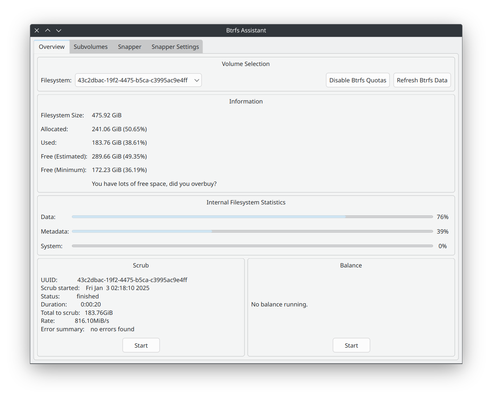
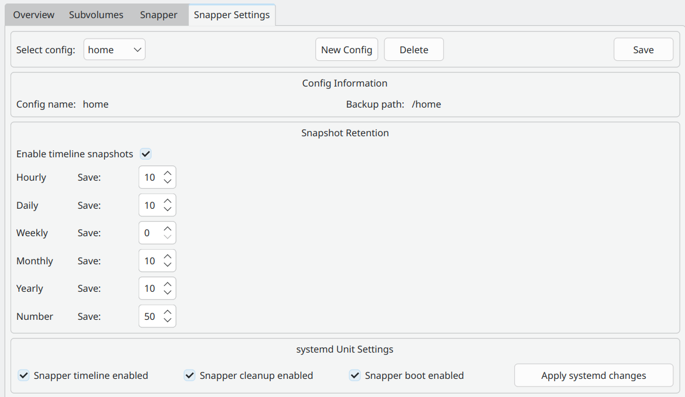

> **Safety correction — November 9, 2026:** This article is a historical introduction, not a verified recovery runbook. The previous deletion, boot-hook and root-rollback recipes have been withdrawn pending a recovery test in a disposable VM. Do not apply them to a working system. A snapshot is not an independent backup, and snapshots do not recursively capture nested subvolumes. See the [Btrfs subvolume documentation](https://btrfs.readthedocs.io/en/stable/btrfs-subvolume.html).
{: .prompt-warning }

Btrfs snapshots can preserve an earlier filesystem state, but creating a snapshot does not prove that a system can be recovered from it. This article introduces the graphical tools; recovery needs a separate, tested procedure for the machine's actual storage and boot layout.

While Snapper is a powerful tool for managing Btrfs snapshots, it requires configuration file editing that some users find challenging. This guide introduces btrfs-assistant, a user-friendly graphical tool that simplifies the snapshot management process on Btrfs filesystems.

## Installation

### Arch

The [Arch package listing](https://archlinux.org/packages/extra/x86_64/btrfs-assistant/) places `btrfs-assistant` in **Extra**, not the AUR (checked November 9, 2026). This corrects the original package-location note; this revision does not claim a fresh installation test.

### Debian

The original article linked unofficial Debian packages. Their current availability and suitability have not been verified in this revision. Consult the [Btrfs Assistant upstream project](https://gitlab.com/btrfs-assistant/btrfs-assistant) before choosing a package source.

### Ubuntu

Installing Snapper alone does not install Btrfs Assistant. The previous section did not provide a complete Ubuntu installation procedure; use the upstream project's instructions for your release instead.

### Fedora

The original article listed `btrfs-assistant` for Fedora. This revision has not rechecked Fedora packaging; verify it against your release's package index before installation.

## Btrfs Assistant

## Configure snapshot through btrfs-assistant

Head over to Snapper setting tab (if you dont see it, install `snapper` package), enter config name, select **subvolume** to back up and choose needed systemd settings and press **Save**. Now  **Timely snapshot** interval settings will pop-up.

The screenshot below shows the original configuration for snapshots of the `/home` subvolume. It is an example, not a recommended layout or an independent backup.

The original setup intended a daily snapshot schedule. Check the resulting snapshots and timer status rather than relying on the screenshot alone.

Btrfs Assistant also allows you to take manual snapshot and manage your snapshots easier

## Before changing an existing snapshot layout

The original article suggested removing `/.snapshots` to resolve a configuration conflict. That advice was too broad. A mountpoint and the subvolume mounted there are different objects; do not delete either without identifying the actual layout and preserving a recoverable copy.

Before making changes, identify which subvolumes are mounted, where snapshots are stored, and what an independent backup covers. If that information is unclear, stop rather than substituting another deletion command.

## Booting snapshots and recovering the system

Booting a snapshot and restoring it as the working root are separate operations. Neither is demonstrated by the screenshots above. The previous initramfs, GRUB-service and manual rollback commands have been removed because they were specific to an old setup and lacked sufficient checks.

Consult the [grub-btrfs upstream documentation](https://github.com/Antynea/grub-btrfs) for its supported setup. A future recovery guide needs a documented subvolume/boot layout, a verified independent backup, a disposable VM rehearsal, and checks after reboot. Until those exist, this article does not provide a copy-and-paste rollback procedure.

## Revision note

November 9, 2026: corrected the Arch package location, clarified incomplete installation notes for other distributions, distinguished snapshots from backups, and withdrew the unverified deletion, boot configuration and root-rollback recipes. No storage or boot commands were executed as part of this editorial correction.
