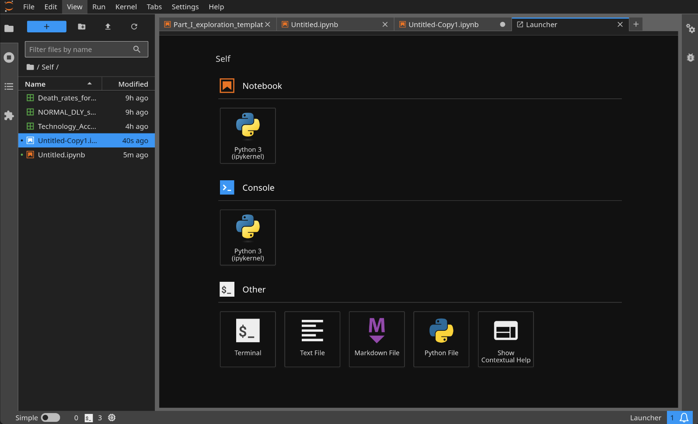

> **Documentation correction — November 9, 2026:** The original article conflated Conda with Anaconda Distribution and incorrectly described `jupyter build` as an initialization step. Those sections are corrected below. The remaining environment examples are historical; this update is not a fresh installation test on Arch Linux.
{: .prompt-warning }

Conda is a package and environment manager. Anaconda Distribution is a distribution that includes Conda; installing a package named after Conda is not by itself an installation of that distribution. See the [Conda documentation](https://docs.conda.io/projects/conda/en/stable/).

## 1.1 Installation

Choose the distribution you intend to use, then follow its installation instructions. The [official Anaconda installation guide selector](https://www.anaconda.com/docs/getting-started/installation) provides separate guides for Anaconda Distribution and Miniconda.

Check the installer architecture and the publisher's verification instructions before running it. Do not choose an installer solely from browser detection.

The earlier AUR `python-conda` command has been withdrawn from this article: its current availability and package contents have not been checked here, and it should not have been presented as equivalent to Anaconda Distribution.

## 2.1 Usage

It is recommended to install new packages in a new environment instead of the base environment. To avoid conda automatically activating the base environment, edit `~/.condarc`:

```conf
auto_activate_base: false
```

### 2.2 Set default packages

Add `create_default_packages` section in `~/.condarc`. For example:

```conf
...
create_default_packages:
  - pip
  - ipython
  - numpy
  - scipy
  - libgcc-ng
  - mpich
  - rust
```

### 2.3 Create an environment

To crate a new environment `myenv` with default packages specified in previous section, run:

```bash
conda create --name myenv
```

To crate a new environment without default packages, run:

```bash
conda create --no-default-packages --name myenv
```

The following is the original version-pinning example, not a recommendation for a new environment. Choose supported versions compatible with your project; this exact combination has not been re-solved in this revision.

```bash
conda create --name myenv python=3.9 numpy=1.23.5 astropy
```

To activate the environment:

```bash
conda activate myenv
```

## 3.1 Install and start JupyterLab

For a dedicated JupyterLab environment, the following example uses `conda-forge`, the channel [recommended by Project Jupyter](https://jupyter.org/install) for Conda installations. Review the package transaction before confirming; this example has not been executed in a fresh Conda installation during this revision.

```bash
conda create --name blog-jupyter --override-channels -c conda-forge python jupyterlab
conda activate blog-jupyter
jupyter lab
```

Open the URL printed by the server. There is no notebook-directory initialization step in this workflow. `jupyter lab build` belongs to a [JupyterLab rebuild workflow](https://jupyterlab.readthedocs.io/en/stable/user/extensions.html), not to creating your first notebook.

For the separate Notebook application, follow [Project Jupyter's installation instructions](https://jupyter.org/install) and launch it with `jupyter notebook`. JupyterLab and Notebook should not be treated as interchangeable package names.



## Revision note

November 9, 2026: distinguished Conda from Anaconda Distribution, withdrew the unverified AUR installation path, marked the old version pins as historical, and replaced the incorrect initialization step with the documented server-launch workflow. No Conda environment was created during this correction.